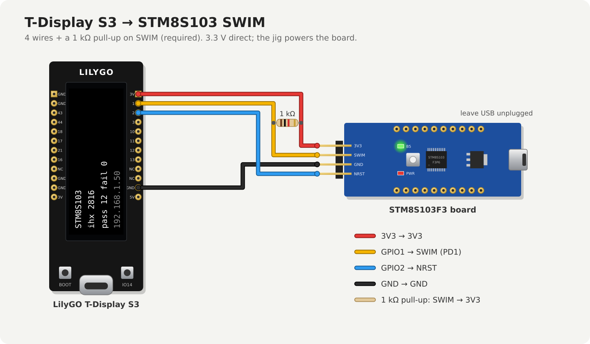

# TDisplayS3-STM8S-Flasher

Standalone production flasher for STM8S103/STM8S003 microcontrollers: a LilyGO
T-Display S3 (ESP32-S3) programs the target over ST's SWIM interface. No PC,
no ST-Link on the line. You upload the target firmware to the jig over WiFi
once; after that an operator connects a board, the jig flashes and verifies
it, and shows PASS or FAIL on its screen. In production use (about 50 boards
so far).

Sibling project for STM32F103 targets: [TDisplayS3-STM32F1-Flasher](https://github.com/holla2040/TDisplayS3-STM32F1-Flasher).

## What you need

| Item | Notes |
|---|---|
| LilyGO T-Display S3, LCD version (not AMOLED), 16 MB flash / 8 MB PSRAM | The build assumes 16 MB flash and OPI PSRAM. |
| Target with an STM8S103F3 or STM8S003F3 | The common blue STM8S103F3 minimum board, or your own PCB. |
| 1 kΩ resistor | SWIM pull-up. **Required.** |
| 4 wires, or a pogo-pin / clip fixture | Keep them short; see [Wiring](#wiring). |
| 5 V USB-C supply for the jig | The jig powers the target from its 3V3 pin. |
| A computer with arduino-cli | Only to build the jig firmware. |

## Build the jig firmware

Tested with arduino-cli 1.3.1, esp32 core 3.3.0, TFT_eSPI 2.5.43 and
WiFiManager 2.0.17 (by tzapu). Other versions probably work; these are known good.

```
arduino-cli config add board_manager.additional_urls https://espressif.github.io/arduino-esp32/package_esp32_index.json
arduino-cli core update-index
arduino-cli core install esp32:esp32@3.3.0
arduino-cli lib install "TFT_eSPI@2.5.43" "WiFiManager@2.0.17"
```

**TFT_eSPI needs one manual edit** or the build succeeds and the screen stays
black. In `<sketchbook>/libraries/TFT_eSPI/User_Setup_Select.h` (sketchbook is
usually `~/Arduino`), comment out `#include <User_Setup.h>` and uncomment
`#include <User_Setups/Setup206_LilyGo_T_Display_S3.h>`. The edit applies to
every sketch that uses TFT_eSPI and is lost when the library is updated.

Clone into a folder named exactly `TDisplayS3-STM8S-Flasher` (arduino-cli
requires the folder to match the .ino name; a GitHub ZIP unpacks to `...-main`,
so rename it). Then, on Linux/macOS:

```
make bin                        # compile into /tmp/arduino-build
make usb port=/dev/ttyACM0      # upload over USB
make test                       # optional: host-side check of the Intel HEX parser (gcc)
```

On Windows, or without make, use arduino-cli directly with the same board settings:

```
arduino-cli compile -b esp32:esp32:esp32s3:CDCOnBoot=cdc,FlashSize=16M,PartitionScheme=app3M_fat9M_16MB,PSRAM=opi --output-dir build .
arduino-cli upload  -b esp32:esp32:esp32s3:CDCOnBoot=cdc,FlashSize=16M,PartitionScheme=app3M_fat9M_16MB,PSRAM=opi -p COM5 --input-dir build .
```

Arduino IDE equivalent: board "ESP32S3 Dev Module", USB CDC On Boot: Enabled,
Flash Size: 16MB, Partition Scheme: "16M Flash (3MB APP/9.9MB FATFS)", PSRAM: OPI PSRAM.

If no serial port shows up for the first USB upload: hold BOOT, tap RST,
release BOOT, then upload. After that, updates can go over WiFi
([Updating the jig](#updating-the-jig)).

## Wiring

3.3 V target, direct connection. Shown here with the common blue STM8S103F3
minimum board and its 4-pin SWIM header:



| T-Display S3 | Target STM8 |
|---|---|
| GPIO 1 | SWIM, plus a **1 kΩ pull-up to 3.3 V** (required: the ESP32's internal pull-up is far too weak for SWIM's rise times) |
| GPIO 2 | NRST |
| GND | GND |
| 3V3 | VDD — the jig powers the target |

- Put the 1 kΩ between SWIM and 3.3 V anywhere along the wire; at the target end is best.
- Leave the target board's own USB unplugged while it's on the jig: that would tie its regulator to the jig's 3V3.
- Keep wires under about 15 cm. SWIM's short bits are 250 ns.
- STM8S103F3/S003F3 pins (TSSOP-20), for your own PCB: SWIM = PD1 (pin 18), NRST = pin 4, VDD = pin 9, VSS = pin 7. Don't load PD1 in the target design.
- **5 V targets: untested.** The STM8S103/003 run from 2.95 V, so if nothing else on the board needs 5 V, power it from the jig's 3.3 V while flashing. Otherwise put an open-drain level shifter on SWIM and NRST, with the 1 kΩ pull-up on the target side to the target's VDD. The ESP32 pins are not 5 V tolerant.
- When testing "board disconnected", unplug SWIM too: an unpowered target can be powered through the SWIM pull-up and still answer.

## First boot and WiFi

WiFi is only needed to load the target image and to watch status from a
browser. Flashing works without it.

1. On first boot the jig opens an open WiFi access point named `STM8Flasher`
   (no password); the screen's bottom line shows `AP: STM8Flasher`.
2. Join it from a phone or laptop. The setup page should pop up; if not, browse
   to http://192.168.4.1/. Pick your network and enter its password.
   2.4 GHz WPA2-PSK only; WPA2-Enterprise (common on factory networks) isn't supported.
3. The jig joins the network and shows its IP address on the bottom line. Its
   web page is at that IP, or `http://STM8Flasher.local/` where mDNS works
   (often not on Windows or corporate networks: use the IP).

The jig remembers the network. If that network is out of range at power-up,
the setup AP comes back by itself. To forget it deliberately, **hold BOOT for
5 seconds** while the jig is running: the screen shows `wifi forgotten` and the
jig restarts into the setup AP. (Don't hold BOOT while powering up: that puts
the ESP32-S3 into its USB download mode instead.)

More than one jig on the same network: give each a unique name by changing
`PROJECTNAME` in `TDisplayS3-STM8S-Flasher.ino` (e.g. `STM8Flasher-2`) before
building. Otherwise their hostnames and setup APs collide.

## Making the target image

The jig takes Intel HEX (`.ihx` / `.hex`) for the 8 KB program flash at
0x8000-0x9FFF.

**Bring-up check**: [`examples/blink/blink.ihx`](examples/blink/blink.c) blinks
the PB5 LED on the blue STM8S103F3 board. Connect a board (the screen shows
`STM8S103` or `STM8S003`), upload it, and look for PASS and a blinking LED
(about 2 Hz). Then load your real image.

- **SDCC**: `sdcc -mstm8 --std-c99 main.c` produces `main.ihx`, linked at 0x8000
  by default. For several source files, compile each with `-c` and link the
  `.rel` files with `sdcc -mstm8 --out-fmt-ihx`.
- **Cosmic / STVD `.s19`**: not accepted. Convert with
  `srec_cat app.s19 -o app.ihx -intel`.
- Data EEPROM (0x4000) and option bytes (0x4800) aren't programmed. A HEX file
  containing them is rejected; strip them first.

## Loading the image onto the jig

Any of:

- The jig's web page: **Target firmware** → choose the file → **Upload and flash**.
- `curl -F ihx=@app.ihx http://<jig-ip>/upload`
- `make image IHX=app.ihx ip=<jig-ip>`

The jig stores the image on its own flash; it survives power cycles and jig
firmware updates. **A board already on the jig is flashed as soon as the upload
finishes.**

To confirm which firmware is loaded, the web page and `/status` show the stored
image's size and CRC32: the CRC32 of the image as a binary starting at 0x8000.
To compute it from your file:
`objcopy -I ihex -O binary --gap-fill 0xff app.ihx app.bin && crc32 app.bin`.

Before replacing the stored image, the jig parses the whole file. It rejects
the file, keeps the previous image, and returns HTTP 400 when a record has a
bad checksum or any data falls outside 0x8000-0x9FFF. Gaps are filled with
0xFF; only record types 00, 01 and 04 are used.

## Production operation

### Operator steps

1. Power the jig. The home screen shows the board status, the image size
   (`ihx <bytes>`), the counters and the IP address.
2. Connect a board. Within about a second the jig switches to the flash screen:
   `write n/total`, then `read n/total`.
3. Read the result bar, then disconnect the board. The result also stays on
   the home screen until the board is removed.
4. Connect the next board.

The jig flashes each board **once per connection**. A board left connected is
never reflashed, whatever its result. To retry, disconnect and reconnect it.
This matters: the STM8S003 is only rated for 100 flash program cycles.

While idle, the jig probes for a board once a second by pulsing NRST and
entering SWIM. **A board left on the jig therefore resets about once a second**:
don't run functional tests while it's connected.

### Screen messages

| Screen | Meaning | What to do |
|---|---|---|
| `no target` | Nothing answered on SWIM. | Check the connection, the 1 kΩ pull-up, and power. |
| `STM8S103` / `STM8S003` | Board detected. Heuristic from the chip's unique-ID area; both have the same flash layout, so it doesn't matter which. | — |
| `no image loaded` | No target image stored yet. | Load one. |
| green `PASS` | Flashed, read back, matched. The board was reset and is running the new firmware. | Good board. |
| red `FAIL verify mismatch` | Read-back didn't match the image. | Reject. A board that FAILs twice is bad. |
| orange `comm error no verdict` | Three attempts couldn't finish. Usually contact or wiring; also a chip with read-out protection set. | Reconnect once. If it repeats, set it aside and check the serial log. |
| `no target, check wiring` | Manual mode: KEY pressed with nothing connected. | — |
| `AP: STM8Flasher` / `wifi: connecting` | Not on WiFi (bottom line). | Only matters for uploads; see [WiFi](#first-boot-and-wifi). |
| `updating flasher` | Jig firmware update in progress. | Wait; it restarts. |

FAIL means one thing only: the read-back didn't match. A missing board or a
communication problem is never shown as FAIL.

A chip with read-out protection (ROP) set from a previous life shows `comm
error`; the serial log typically shows `flash unlock rejected`. Clear it with an ST-Link
(`stm8flash -c stlinkv2 -p stm8s103f3 -u`), which erases the chip.

### Counters, buttons and mode

- `pass` and `fail` count flash results since power-up, not boards: a board
  reconnected and flashed again counts again. They reset on power-cycle;
  record them first. `comm error` counts as neither.
- Auto mode (the default) flashes every newly connected board. The mode isn't
  shown on the screen; the web page shows it. A short press of BOOT switches
  to manual mode, where nothing flashes until KEY (GPIO14) is pressed. If
  boards are detected but never flash, the jig is in manual mode: press BOOT
  once or power-cycle (it always starts in auto).
- KEY during the 1 s result display re-flashes the same board, in either mode.
- BOOT held 5 s forgets WiFi ([above](#first-boot-and-wifi)).

## Supported targets and limits

- STM8S103F3 and STM8S003F3 (8 KB flash, 64-byte blocks). The jig is built for
  this layout (`target` in `TDisplayS3-STM8S-Flasher.ino`).
- Other STM8S parts need a device-table entry in `stm8.cpp` (values from
  [stm8flash](https://github.com/vdudouyt/stm8flash)'s `stm8.c`) and `target`
  pointed at it. An STM8S105 entry exists but isn't tested.
- Program flash only: data EEPROM and option bytes aren't written.
- PASS checks the flash contents only. Option bytes and read-out protection
  aren't checked, and the board isn't functionally tested.

## Updating the jig

The target image and the WiFi settings survive a jig update.

- **Web page**: **Flasher firmware** → choose `TDisplayS3-STM8S-Flasher.ino.bin`
  from the build folder (not the `.merged.bin` or `.bootloader.bin`) → **Update flasher**.
  The page reports when the jig is back on the new firmware.
- **curl**: `curl -F firmware=@TDisplayS3-STM8S-Flasher.ino.bin http://<jig-ip>/update`
- **ArduinoOTA**: `make ota ip=<jig-ip>` (uses espota.py from the esp32 core; set
  `ESPOTA=` if yours lives elsewhere).
- **USB**: `make usb port=/dev/ttyACM0`.

ArduinoOTA from WSL2: espota needs the jig to connect back to the PC. Set
`networkingMode=mirrored` in `%USERPROFILE%\.wslconfig` (then `wsl --shutdown`),
allow inbound TCP 3233 in both the Windows firewall and the Hyper-V firewall
for WSL, and add `-P 3233` to the espota command. The web page method avoids all of this.

## Troubleshooting

The jig logs to USB serial at 115200 baud
(`arduino-cli monitor -p /dev/ttyACM0 -c baudrate=115200`).

| Log line | Meaning |
|---|---|
| `swim: entry sent, no sync pulse` | No target, no power, or the pull-up is missing. |
| `swim: sync pulse NN us after NN us` | Target answered; the width sets this chip's bit timing. With `(expected 8-40 us)` appended, the width was out of range and entry failed: wiring or rise time. |
| `swim: sync pulse stuck low >100us` | SWIM held low: wiring short, or the pull-up missing. |
| `stm8: SWIM_CSR write failed (entry ok, frames not acked)` | Entry worked, data frames didn't: weak pull-up or long wires. |
| `stm8: CPU stall (DM_CSR2) write failed` | Same family of problem, one step later. |
| `stm8: connected, core stalled` | Ready to program. |
| `stm8: flash unlock rejected, IAPSR=0x..` | Often read-out protection on a reused part. |
| `stm8: EOP timeout` / `stm8: block @ 0x.... failed` | A flash block didn't program. |
| `stm8: block @ 0x.... ok on readback (EOP missed)` | Recovered: harmless. |
| `stm8: verify mismatch @ 0x....: wrote 0x.. read 0x..` | The FAIL detail. |
| `flash: comm error, attempt n/3` | Retrying within one connection. |

## Integration and security

- `GET /status` returns JSON, e.g.
  `{"detected":"STM8S103","image":2816,"crc":"1a2b3c4d","pass":12,"fail":0,"auto":true,"build":"...","md5":"..."}`.
  `image` and `crc` are the stored target image's size and CRC32; `md5` identifies the jig firmware.
  There's no per-board log or serial-number traceability.
- **Nothing is authenticated**: the setup AP, `/upload`, `/update` and
  ArduinoOTA are open to anyone on the same network. Anyone who can reach the
  jig can replace the target image or the jig firmware. Put jigs on an
  isolated network.

## Design

See [docs/architecture.md](docs/architecture.md) for how the SWIM driver and
the flash cycle work.

## License

MIT — see [LICENSE](LICENSE).
